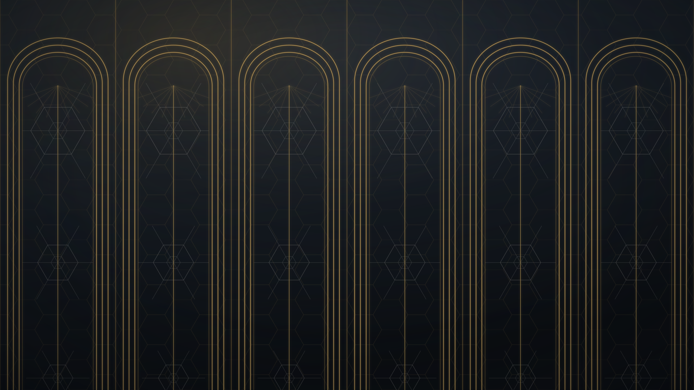
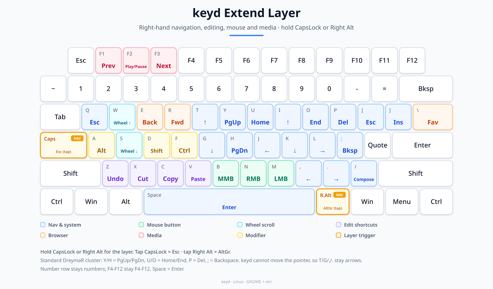

# tuxedo-bazzite

Custom [Bazzite](https://universal-blue.org/bazzite/) image with Tuxedo drivers for Tuxedo/Clevo laptops.

Adds the Tuxedo kernel modules (`tuxedo_io`, `tuxedo_keyboard`, `clevo_acpi`, etc.) and [Tuxedo Control Center](https://github.com/tuxedocomputers/tuxedo-control-center) on top of upstream Bazzite, so fan control, keyboard backlight, and temperature sensors work out of the box.

## Available Images

One image is built and published to `ghcr.io/akopper/`:

| Image | Base | Description |
|---|---|---|
| `tuxedo-bazzite-gnome-niri-nvidia` | `bazzite-gnome-nvidia-open:stable` | Bazzite GNOME + niri (with Noctalia) + NVIDIA **open** drivers + Tuxedo drivers |

> Earlier variants (KDE, GNOME without niri, non-NVIDIA) were discontinued in October 2026. Tags that may still exist on ghcr are stale snapshots from that time — do not rebase to them.

## What's included

- **[Tuxedo Drivers](https://gitlab.com/tuxedocomputers/development/packages/tuxedo-drivers)** — kernel modules built via `akmod-tuxedo-drivers` from the Tuxedo RPM repo, signed for Secure Boot
- **[Tuxedo Control Center](https://github.com/tuxedocomputers/tuxedo-control-center)** — GUI and `tccd` service for fan/LED/power profiles
- **[keyd](https://github.com/rvaiya/keyd)** — system-wide Extend/nav layer (hold CapsLock or Right Alt), following DreymaR's Extend layout. Config: [`keyd/default.conf`](keyd/default.conf); layout: [`pictures/keyd-extend-layer.png`](pictures/keyd-extend-layer.png)
- **[OpenRGB](https://openrgb.org/)** — built from a pinned upstream commit (newer than the Fedora package, which misassigns almost every key on this keyboard) with three additions: an extra HID detector for `048d:6004` (upstream only knows `048d:600b`, the Stellaris/Polaris Gen4 uses the same ITE 8291 protocol), the measured per-key LED map of the Stellaris/Polaris Gen4 (`STEPOL1XA04`), which fixes right Shift, the arrow keys, the ISO `<` key, numpad `+`/`-` and Print Screen, and a sysfs controller for the front lightbar (the TUXEDO/Uniwill EC exposes it as three monochrome LEDs). Per-key colours, effects, profiles, the lightbar colour and its animation mode work
- **[yt6801 Ethernet Driver](https://github.com/h4rm00n/yt6801-linux-driver)** — for Motorcomm NICs (signed for Secure Boot)
- **[niri](https://github.com/niri-wm/niri)** — scrollable-tiling Wayland compositor (niri variants only)
- **[Noctalia](https://noctalia.dev/)** — native C++/OpenGL ES shell for niri (niri variants only)
- **dGPU rendering for external monitors** — `ujust setup-dgpu` configures niri to render on the NVIDIA dGPU, eliminating lag on external monitors wired to the dGPU (NVIDIA niri variant only)
- **[Sunshine](https://app.lizardbyte.dev/)** — game streaming host (Moonlight), installed as an RPM with `CAP_SYS_ADMIN` so it captures via KMS. The flatpak cannot do KMS capture, and the XDG-portal path it is stuck with does not work on niri or on hybrid AMD/NVIDIA Wayland setups. Runs as the systemd user unit `sunshine.service` from `graphical-session.target`
- **[Voxtype](https://voxtype.io/)** — local push-to-talk dictation from the upstream RPM, with `dotool`/`wtype`/`wl-clipboard` installed for text output. Runs on the CPU (AVX2) by default: measured on this laptop it transcribes ~2.5x faster than the Radeon 680M, and it never touches the NVIDIA dGPU. A shipped systemd user drop-in pins `VK_DRIVER_FILES`/`VK_ICD_FILENAMES` to the Mesa RADV manifest, so opting into the iGPU (`VOXTYPE_GPU=1`) still leaves the dGPU in runtime suspend. Not started by default: run `voxtype setup --download && systemctl --user enable --now voxtype.service` once per user. (Handy remains the live AppImage setup.)
- Everything from upstream Bazzite

## Kumiko theme (optional)

A self-contained dark theme built around a custom Art-Deco / kumiko wallpaper:
ink background, brass arch panels, a kikko (tortoise-shell) lattice and asanoha
(hemp-leaf) stars.



```bash
ujust setup-kumiko
```

This installs the wallpaper, the `Kumiko` Noctalia palette and the pinned niri
theme, switches Noctalia to the palette in dark mode, and adds the following
to `~/.config/niri/config.kdl`:

```kdl
include "noctalia.kdl"
include "theme-kumiko.kdl"
```

The theme include comes last so the brass colours survive Noctalia
regenerating its own `noctalia.kdl`. Files:

| File | Purpose |
|---|---|
| `niri/wallpapers/kumiko-deco.svg` | Editable wallpaper source |
| `niri/wallpapers/kumiko-deco-3840x2160.png` | 4K render |
| `niri/wallpapers/kumiko-deco-2560x1440.png` | Native 16:9 render |
| `niri/wallpapers/generate_kumiko.py` | Generator (Python standard library only) |
| `niri/palettes/Kumiko.json` | Custom Noctalia palette (dark + light) |
| `niri/theme-kumiko.kdl` | Pinned niri focus ring, borders and tabs |

To go back, remove the two includes above and run
`noctalia msg color-scheme-set wallpaper m3-content`.

## Extend/nav layer (keyd)

Hold **CapsLock** or **Right Alt** for the Extend layer. Tap CapsLock for Esc, tap Right Alt for AltGr.



- Right hand: `YUIOP` = PgUp/Home/↑/End/Delete, `HJKL;` = PgDn/←/↓/→/Backspace.
- Cursor: `T`/`G` = ↑/↓, `,`/`.` = ←/→.
- Mouse: `M`/`N`/`B` = left/right/middle click.
- Wheel: `W`/`S` = up/down.
- Editing: `Z`/`X`/`C`/`V` = undo/cut/copy/paste; `A`/`D`/`F` = Alt/Shift/Ctrl.
- Browser/system: `E`/`R`/`\` = back/forward/favorites, `[` = Esc, `]` = Ins, `/` = Compose.
- Media: `F1` = previous, `F2` = play/pause, `F3` = next.
- `Space` = Enter.

keyd cannot move the mouse pointer natively, so DreymaR's pointer-motion keys (`T`/`G`/`,`/`.`) are mapped to the arrow keys. `W`/`S` remain wheel up/down.

If a bad config ever locks up the keyboard, press `Backspace`+`Esc`+`Enter` to stop keyd.

---

## Known behaviour: the dGPU never sleeps while TCC is open

On hybrid AMD iGPU + NVIDIA dGPU laptops the NVIDIA card idles at ~15 W instead of ~0 W as long as the Tuxedo Control Center window is open. The reason is in the GUI, not in the power profile: its dashboard worker polls `tccd` twice per second (`SetDGpuD0Metrics`, `GetSensorDataCollectionStatus`), and that path ends up calling `nvidia-smi` for the dGPU values. Every call touches the GPU, so runtime D3 never engages.

- **Fix:** quit TCC (tray icon → Quit) when you don't need it. `tccd` keeps running and keeps applying the profiles — including the `power_ac`/`power_bat` profile switching — so nothing is lost. The card then suspends within ~15 s.
- **Not the cause:** the TCC power profile itself, `nvidia-powerd`, `nvidia-persistenced`, OpenRGB, niri, or any compositor GPU probing. Stopping all of those does *not* let the dGPU sleep; closing the TCC window does (verified with `SIGSTOP`/`SIGCONT` on the GUI).
- **Why profile switches look like the trigger:** switching a profile pauses that polling loop for ~1 s, RTD3 slips in, and the next poll wakes the card again. That one-second `D3Cold` blip is what you see in `cardwired`'s log.
- **Do not verify with `nvidia-smi` or `nvtop`** — they wake the card themselves (and report nonsense such as 752 W while it is suspended). Watch the runtime PM node instead (adjust the PCI address for your machine):

```bash
watch -n1 cat /sys/bus/pci/devices/0000:01:00.0/power/runtime_status
```

`suspended` = powered down, `active` = awake. `/proc/driver/nvidia/gpus/*/power` additionally reports `Runtime D3 status` and whether VRAM is `Active`.

---

## Installation

### 1. Rebase to the custom image

From any Bazzite installation (or Fedora Silverblue/Kinoite with ostree):

```bash
rpm-ostree rebase ostree-unverified-registry:ghcr.io/akopper/tuxedo-bazzite-gnome-niri-nvidia:latest

# Reboot
systemctl reboot
```

### 2. Enroll the MOK signing key (Secure Boot)

The Tuxedo kernel modules are signed with a custom MOK (Machine Owner Key) that is **not** enrolled by default. After the first boot into the new image you must enroll it once:

```bash
# Import the key into the MOK enrollment queue
sudo mokutil --import /etc/pki/akmods/certs/akmods-persistent.der
```

You will be prompted for a password. Use:

```
password
```

Then reboot. At the blue **MOK Manager** screen:

1. Select **"Enroll MOK"**
2. Select **"View key"** (optional) then **"Continue"**
3. Enter the password: `password`
4. Select **"Reboot"**

After reboot the Tuxedo modules will load automatically.

### 3. Verify

```bash
# Check modules are loaded
lsmod | grep -E "tuxedo|clevo|uniwill"

# Check temperatures
sensors

# Tuxedo Control Center should be in your app menu, or:
tuxedo-control-center
```

---

## Rebase to signed image (optional)

Once you've verified the unsigned image works, you can switch to the cosign-signed version:

```bash
rpm-ostree rebase ostree-image-signed:docker://ghcr.io/akopper/tuxedo-bazzite-gnome-niri-nvidia:latest
systemctl reboot
```

Verify the signature:

```bash
cosign verify --key cosign.pub ghcr.io/akopper/tuxedo-bazzite-gnome-niri-nvidia:latest
```

---

## How it works (Secure Boot signing)

Bazzite's base image ships with a kernel signing key ("ublue kernel") that is enrolled in MOK. Private kernel modules built during image creation (like the NVIDIA driver) are signed with this key. However, the ublue **private key** is not included in the image — it's only available in Universal Blue's build pipeline.

When this custom image builds on top of Bazzite, `kmodgenca` would normally generate a **new** signing key for akmods. That key is not enrolled in MOK, so the kernel rejects the modules with `Key was rejected by service`.

To fix this, the build injects a **persistent key pair** (stored as GitHub repo secrets `AKMODS_PRIVATE_KEY_B64` and `AKMODS_PUBLIC_KEY_B64`). CI writes them to temporary files and mounts them into the build via `RUN --mount=type=secret` (`--secret=...` on the CLI). The key is **never passed as a build argument**: build args are recorded in the published image's layer history, which is exactly how the previous key pair leaked in November 2026 and had to be rotated. The `akmods-ostree-post` script then builds and signs the modules with this key. The same key pair is reused on every rebuild, so it only needs to be enrolled in MOK **once** per machine.

The yt6801 Ethernet driver is also manually signed with the same key using `scripts/sign-file`.

## Auto-updates

This image is automatically rebuilt twice a week (Monday & Thursday) via GitHub Actions.
[Renovate](https://www.renovatebot.com/) automatically creates PRs when upstream Bazzite base images are updated and auto-merges them.

## Credits

- [fnyaker/ublue-tuxedo-tcc](https://github.com/fnyaker/ublue-tuxedo-tcc) — Original Tuxedo driver build scripts
- [BrickMan240/ublue-tuxedo-tcc](https://github.com/BrickMan240/ublue-tuxedo-tcc) — Original Tuxedo image concept
- [Universal Blue](https://universal-blue.org/) — Bazzite base image
- [TUXEDO Computers](https://www.tuxedocomputers.com) — Drivers and Control Center
- [derfl007/wayblue-nvidia-muskoxen](https://github.com/derfl007/wayblue-nvidia-muskoxen) — Noctalia setup script and niri config inspiration
- [DataLabTechTV/dltos](https://github.com/DataLabTechTV/dltos) — niri + Noctalia on Bazzite reference
